# RIMFALL

An original neon vector tube shooter for the browser. Hold the rim of a glowing 3D web and blast everything climbing up from the far end.

**▶ Play: https://wigy.github.io/rimfall/**

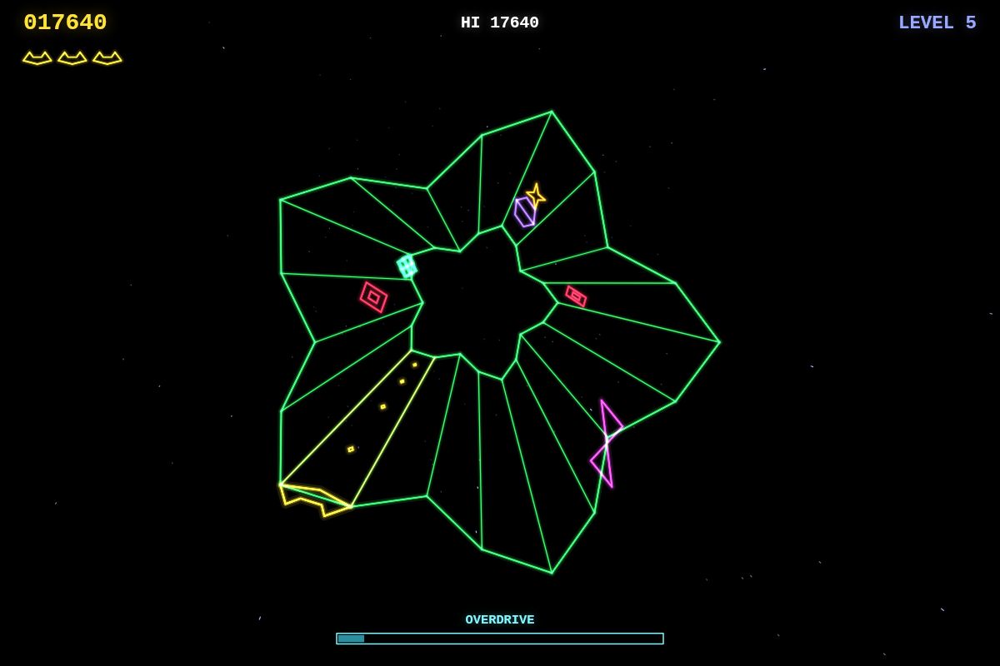

| | |
|---|---|
| 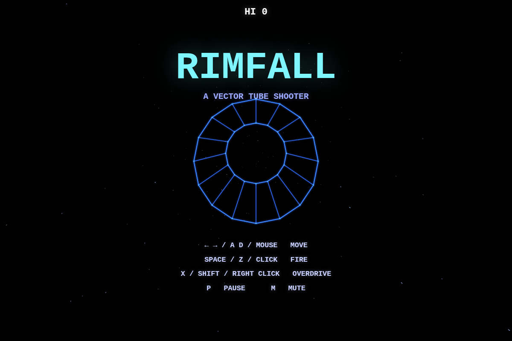 | 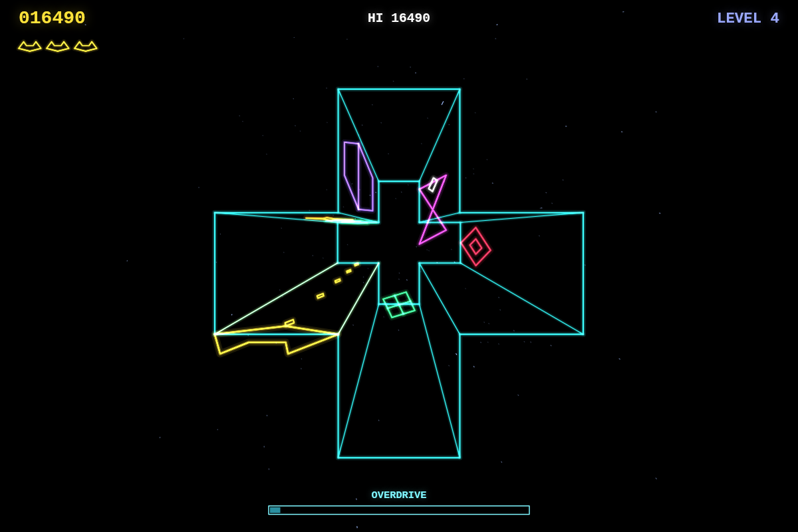 |
| 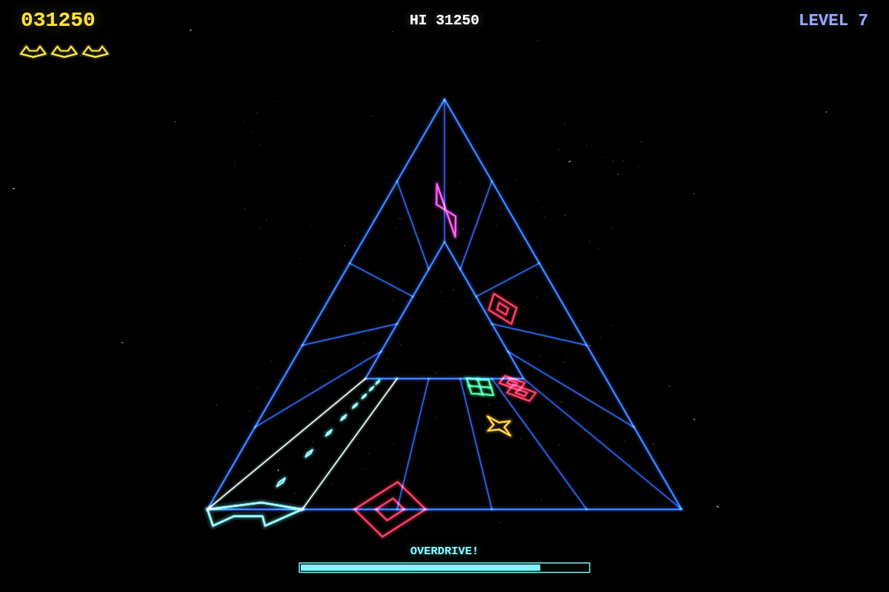 | 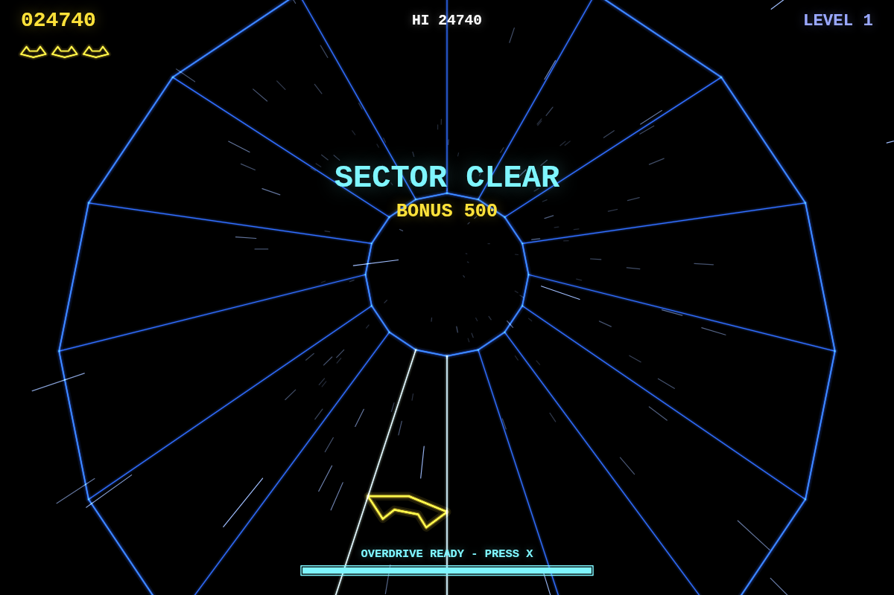 |

## How to play

| Action | Keyboard | Mouse | Touch |
|---|---|---|---|
| Move | ← → / A D | move (pointer is captured while playing) | drag |
| Fire | Space / Z | left button | hold |
| Overdrive | X / Shift | right button | two-finger tap |
| Pause / mute | P / M | | |

Clear every enemy to finish the sector and dive down the tube to the next web. You can still steer and fire during the dive, so dodge any thorns or shoot them out of the way. There are [12 web shapes](#levels), some closed and some open.

**Enemies**

- **Drifter** (red diamond): climbs its lane, then chases you along the rim.
- **Weaver** (magenta bowtie): swings across lanes and fires shots at you. Shoot the shots, too.
- **Splitter** (violet hexagon): breaks into two drifters when hit.
- **Seeder** (green box, takes 2 hits): drops slowly rising mines, then retreats. Leaves a thorn behind it as it climbs.
- **Mine** (orange star): explodes when it reaches the rim, killing you if you're in its lane.
- **Thorn** (lime barbed line): stays in its lane and blocks your shots. Each hit burns it back, and an overdrive shot burns through it. It can't touch you on the rim, but it's fatal if you hit it during the dive.

Kills fill the **Overdrive** meter. When it's full, trigger it for 5 seconds of rapid fire that pierces through everything. You get an extra life every 20,000 points.

## Levels

Click a picture to see it full size. After level 12 the shapes repeat, with faster enemies and bigger waves.

<table>
  <tr>
    <td align="center"><a href="docs/screenshots/levels/01-ring.png">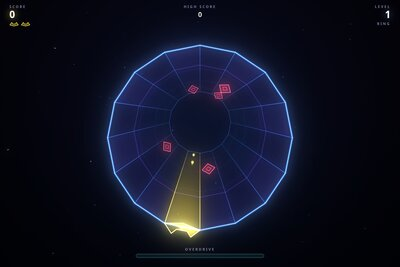</a><br><b>1. Ring</b><br>16 lanes, closed</td>
    <td align="center"><a href="docs/screenshots/levels/02-box.png">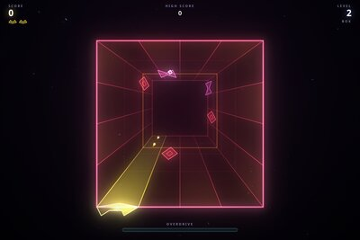</a><br><b>2. Box</b><br>16 lanes, closed</td>
    <td align="center"><a href="docs/screenshots/levels/03-chevron.png">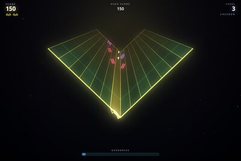</a><br><b>3. Chevron</b><br>14 lanes, open</td>
    <td align="center"><a href="docs/screenshots/levels/04-cross.png">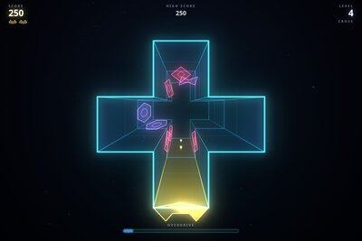</a><br><b>4. Cross</b><br>12 lanes, closed</td>
  </tr>
  <tr>
    <td align="center"><a href="docs/screenshots/levels/05-bloom.png">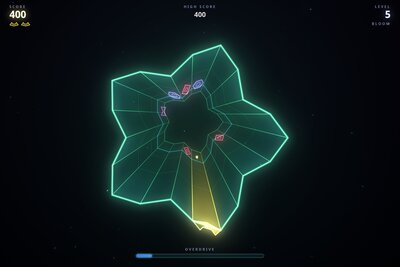</a><br><b>5. Bloom</b><br>20 lanes, closed</td>
    <td align="center"><a href="docs/screenshots/levels/06-ledge.png">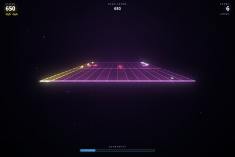</a><br><b>6. Ledge</b><br>14 lanes, open</td>
    <td align="center"><a href="docs/screenshots/levels/07-delta.png">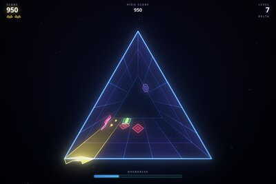</a><br><b>7. Delta</b><br>15 lanes, closed</td>
    <td align="center"><a href="docs/screenshots/levels/08-bowl.png">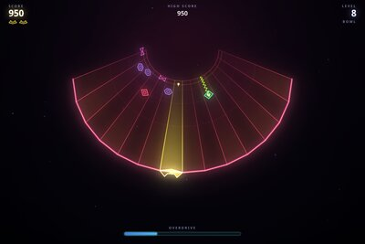</a><br><b>8. Bowl</b><br>14 lanes, open</td>
  </tr>
  <tr>
    <td align="center"><a href="docs/screenshots/levels/09-octastar.png">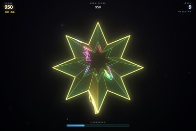</a><br><b>9. Octastar</b><br>16 lanes, closed</td>
    <td align="center"><a href="docs/screenshots/levels/10-swell.png">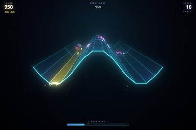</a><br><b>10. Swell</b><br>15 lanes, open</td>
    <td align="center"><a href="docs/screenshots/levels/11-capsule.png">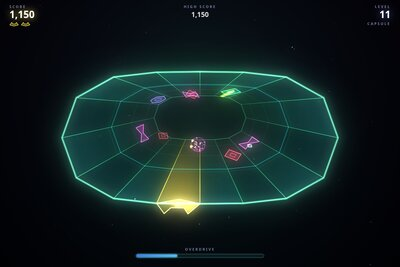</a><br><b>11. Capsule</b><br>16 lanes, closed</td>
    <td align="center"><a href="docs/screenshots/levels/12-steps.png">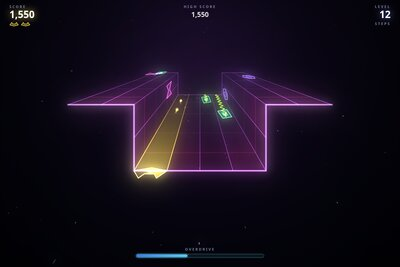</a><br><b>12. Steps</b><br>12 lanes, open</td>
  </tr>
</table>

## Development

Requires Node.js 24 or later.

```bash
npm install
npm run dev      # http://localhost:5173
npm test         # Vitest unit tests for the game logic
npm run build    # typecheck + production build into dist/
```

The game is plain TypeScript and Canvas 2D with no runtime dependencies, and all sound is synthesized with WebAudio. Every push to `main` is tested, built and deployed to GitHub Pages. See [CLAUDE.md](CLAUDE.md) for an architecture overview.
