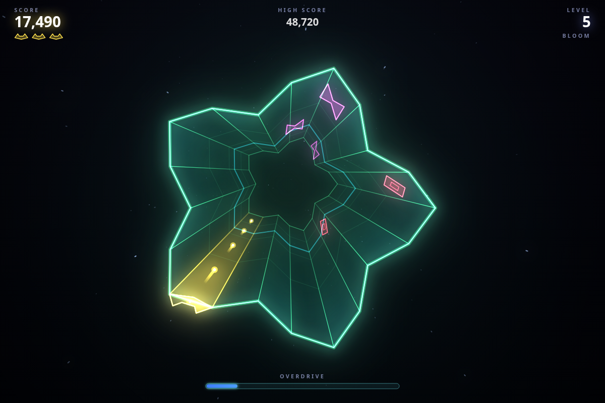
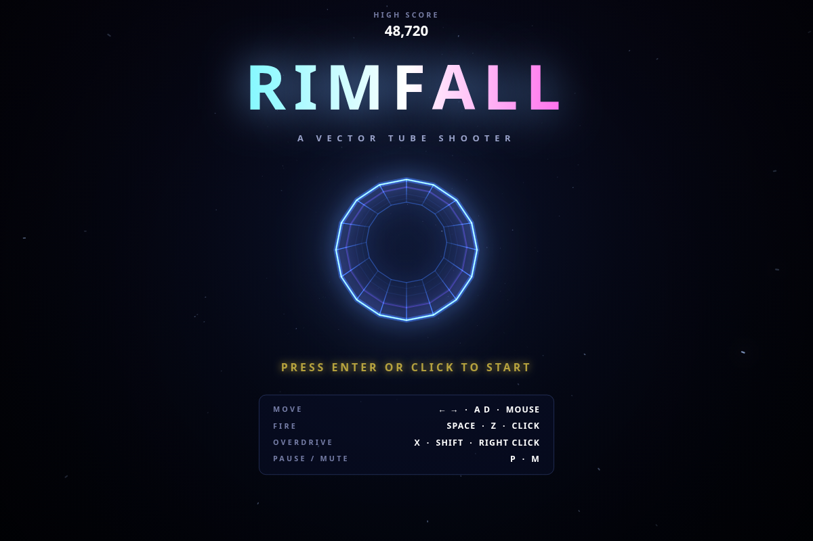
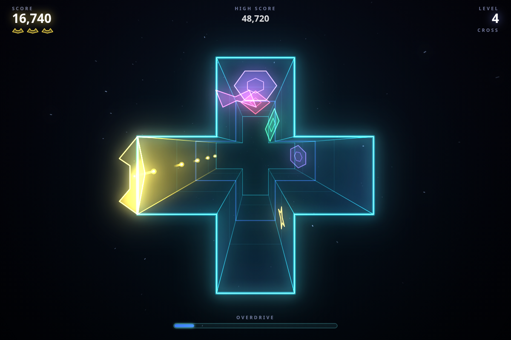
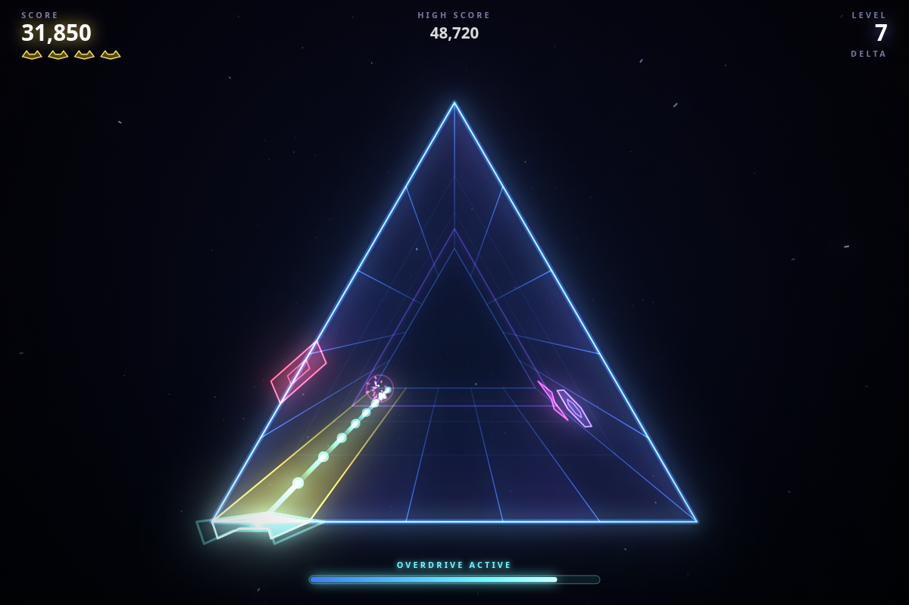
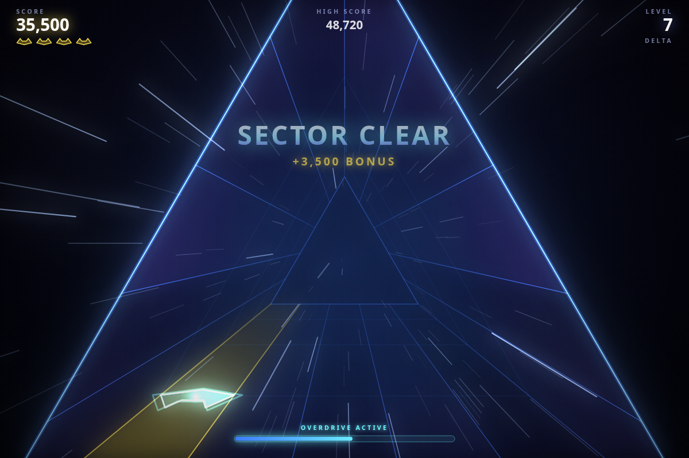

# RIMFALL

An original neon vector tube shooter for the browser. Hold the rim of a glowing 3D web and blast everything climbing up from the far end.

**▶ Play: https://wigy.github.io/rimfall/**



| | |
|---|---|
|  |  |
|  |  |

## How to play

| Action | Keyboard | Mouse | Touch |
|---|---|---|---|
| Move | ← → / A D | move (pointer is captured while playing) | drag |
| Fire | Space / Z | left button | hold |
| Overdrive | X / Shift | right button | two-finger tap |
| Pause / mute | P / M | | |

Clear every enemy to finish the sector and dive down the tube to the next web. There are 12 web shapes, some closed and some open.

**Enemies**

- **Drifter** (red diamond): climbs its lane, then chases you along the rim.
- **Weaver** (magenta bowtie): swings across lanes and fires shots at you. Shoot the shots, too.
- **Splitter** (violet hexagon): breaks into two drifters when hit.
- **Seeder** (green box, takes 2 hits): drops slowly rising mines, then retreats.
- **Mine** (orange star): explodes when it reaches the rim, killing you if you're in its lane.

Kills fill the **Overdrive** meter. When it's full, trigger it for 5 seconds of rapid fire that pierces through everything. You get an extra life every 20,000 points.

## Development

Requires Node.js 24 or later.

```bash
npm install
npm run dev      # http://localhost:5173
npm test         # Vitest unit tests for the game logic
npm run build    # typecheck + production build into dist/
```

The game is plain TypeScript and Canvas 2D with no runtime dependencies, and all sound is synthesized with WebAudio. Every push to `main` is tested, built and deployed to GitHub Pages. See [CLAUDE.md](CLAUDE.md) for an architecture overview.
